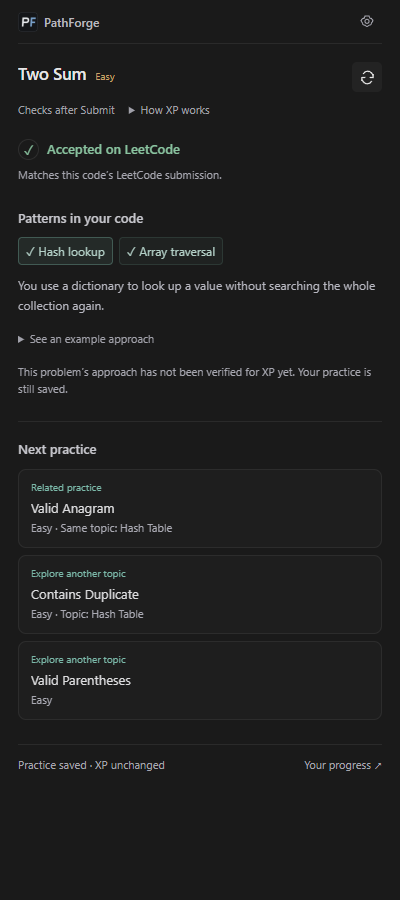
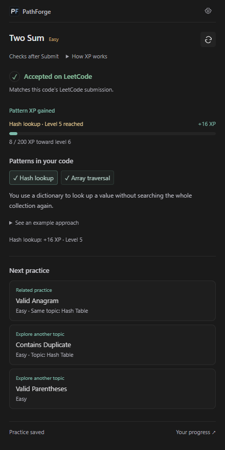
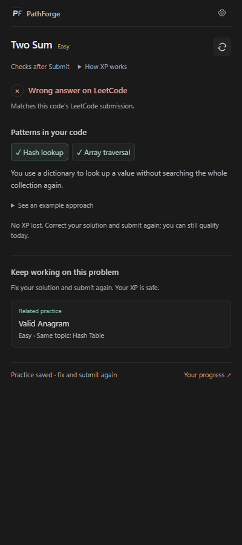
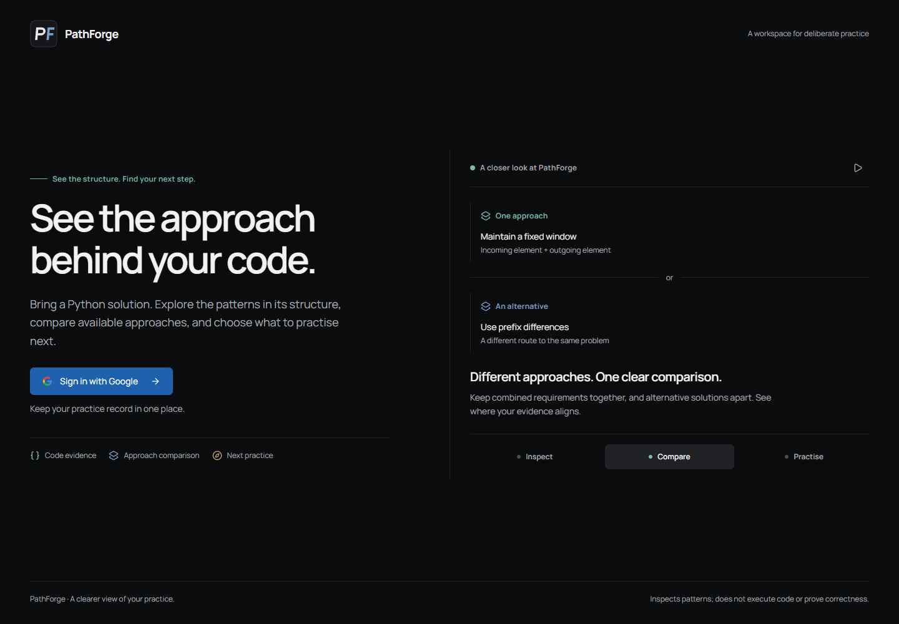
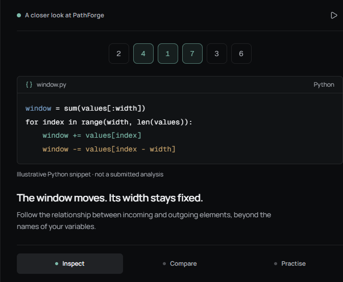
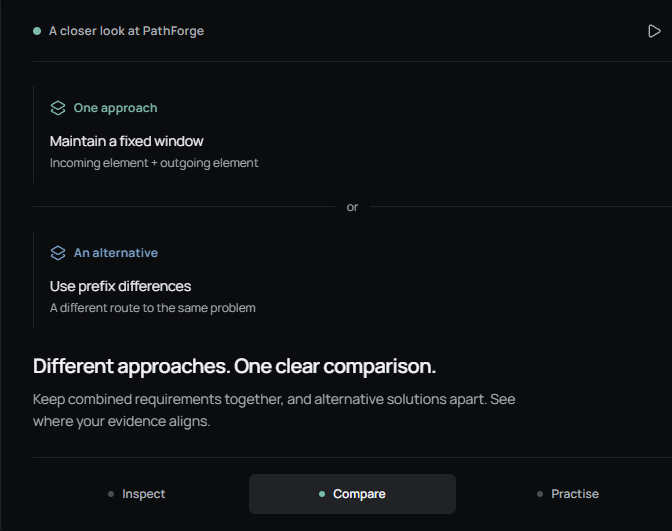
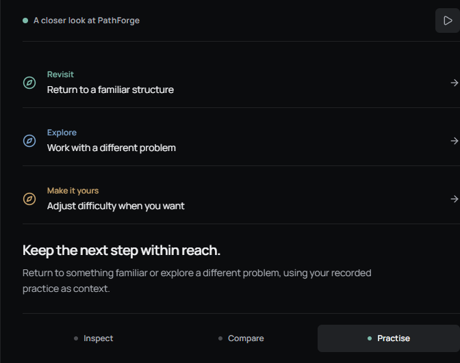

# PathForge V2

> A code analysis tool for figuring out **how a Python solution actually works**.

[](https://path-forge-v2.vercel.app/)
[](https://github.com/vedanshmehrotra/PathForge-v2)
[](https://addons.mozilla.org/en-US/firefox/addon/pathforge-companion/)

---

## On LeetCode

The **PathForge Companion** reads your Python solution from LeetCode, explains supported patterns, and saves practice to the same account as the website.

1. [Install the Firefox add-on](https://addons.mozilla.org/en-US/firefox/addon/pathforge-companion/).
2. Sign in on PathForge in the same browser, then choose **Connect account** in the sidebar.
3. Write and submit on LeetCode. Open a detected pattern to understand it, then choose a related question when you are ready.

Python/Python3 only. LeetCode supplies correctness; detected patterns do not prove correctness or mastery. Drafts and Run/Test do not change XP. Eligible rating updates appear as a brief pattern-level bar; repeated scans do not earn another reward.

<p align="center">
  
  
  
</p>

These are browser captures of the **0.5 release candidate with illustrative sample data**. Store availability follows Mozilla approval. [Release notes, listing material and verification](docs/releases/companion-0.5.0.md) · [Chrome installation](extension/README.md) · [Firefox / Zen installation](extension-firefox/README.md)

---

## The idea

Most coding platforms stop at *accepted* or *wrong answer*.

PathForge tries to look one step further:

**What strategy is actually present in the code?**

A Python submission is parsed into an AST and examined for structural evidence. When a problem is selected, PathForge compares those observations with the approaches available for that problem.

The goal is to make the reasoning behind a pattern observation visible and testable. PathForge inspects code; it does not execute the solution or certify that it is correct.

> A detector saying `dynamic programming` means a lot more when there is actual structural evidence behind it.

---

## 📸 The app

These captures show the current public landing page and its product tour. The code and practice examples are illustrative; they are not results from a user account.



<p align="center">
  
  
  
</p>

---

## What happens to a submission?

```text
Python solution
      ↓
   Parse Python AST
      ↓
Observe code structure
      ↓
Collect detector evidence
      ↓
Qualify pattern observations
      ↓
Compare with available approaches
      ↓
Save eligible practice and recommend a next problem
```

The interesting part is in the middle.

PathForge looks at implementation details such as control flow, loops, state changes, index relationships, membership checks, and table access.

That means it analyses the **implementation**, not just the problem statement. Code-only analysis is available too; without a selected problem, it does not compare approaches or update problem-linked practice.

---

## 🔍 Pattern detection

The detector system is built around independent structural detectors. They examine the same parsed AST and produce evidence for specific code patterns.

Each detector:

- gets the same parsed AST
- looks for one specific pattern
- produces structured evidence
- applies its own decision rules
- does not depend on another detector's output
- produces deterministic results for the same input

Detection and product use are separate decisions. The broader Shadow pipeline can qualify observations and assess strategy authority, but it remains observational; Shadow results do not directly update learner progress or recommendations.

```text
Evidence
   ↓
Confidence
   ↓
Gating rules
   ↓
Detected / Not detected
```

Detector confidence describes evidence strength. It is not the probability that the code is correct, and a raw observation is not automatically a confirmed algorithmic approach.

---

## 🧩 Matching

When a problem is prepared, PathForge compares detected patterns with the available solution approach groups. The comparison keeps patterns that must be used together distinct from alternative approaches.

The comparison distinguishes complete matches, partial overlap, no match, and cases where the evidence is not sufficient to evaluate the comparison. A listed pattern match does not prove that a solution passes the problem.

For each approach, the UI shows which listed patterns were observed and which were not. Proposed, legacy, or incomplete approach data stays clearly qualified instead of being presented as reviewed ground truth.

Problem-linked analysis can contribute to your saved practice record. Recommendations use that history to suggest revisits, related follow-ups, and new problems from the current bank. You can filter by difficulty or skip a suggestion; skips are kept in this browser for 30 days.

The Learning Progress page gives that record a practice footprint, so you can choose which patterns to focus on next.

---

## One part I care about: evidence

This is probably the less flashy part of PathForge, but it matters.

A pattern suggested by a model or observed in code is not automatically treated as ground truth.

The system keeps track of where evidence came from:

```text
llm_proposed
structurally_observed
externally_listed
unobserved
conflicted
```

Those distinctions keep observations, proposed approaches, and product authority separate.

For example, low-authority information can stay in:

```text
analysis_only
```

instead of directly changing a learner's:

- ELO
- topic profile
- gap signals
- recommendations

That lets PathForge separate:

**"the code appears to use this pattern"**

from:

**"this information is eligible to update the learner's saved practice record."**

The experimental Shadow analysis is kept separate from product consequences. Its product gate is off by default, so Shadow findings do not directly change ELO, topic profiles, gaps, or recommendations.

---

## ⚙️ Under the hood

The main analysis path looks roughly like this:

```text
    Python solution                    LeetCode problem
          │                                  │
          ▼                                  ▼
   Parsed Python AST                Problem preparation
          │                                  │
          ▼                                  ▼
   Detector evidence              Available approach groups
          └────────────────┬─────────────────┘
                           ▼
                  Approach comparison
                           │
                           ▼
               Eligible saved practice
                           │
                           ▼
          Calendar-aware recommendations
```

Problem preparation and code analysis are separate API operations. Preparation resolves the problem's available approach data; analysis inspects the submitted Python code and records only eligible, problem-linked practice.

The V2 AST components currently live around:

```text
src/ast_detection/
├── parser.py
├── detector_manager.py
├── coordinator.py
├── output_pipeline.py
├── detectors/
└── tests/
```

The repository also contains the application layer, frontend, database code, evaluation scripts, and the architecture documents that came out of the design process.

---

## 🧪 Testing

Testing is split across the main parts of the system rather than relying only on the UI.

The repository contains automated tests and evaluation material for:

- AST detectors
- matching
- evidence handling
- ground-truth construction
- adversarial cases
- product-level behaviour

Useful design and review documents:

- [Implementation audit](docs/phase_reports/IMPLEMENTATION_AUDIT_REPORT.md)
- [AST architecture](docs/architecture/AST_ARCHITECTURE.md)
- [Matching engine](docs/architecture/MATCHING_ENGINE.md)
- [Detector decision rule](docs/architecture/DETECTOR_DECISION_RULE.md)
- [Product review](docs/audits/PRODUCT_REVIEW.md)

---

## 🛠️ Tech stack

<p>
  
  
  
  
</p>

<p>
  
  
  
  
</p>

<p>
  
  
  
  
</p>

---

## 🚀 Running it locally

### Backend

Create a virtual environment:

```bash
python -m venv .venv
```

Activate it and install the dependencies:

```bash
pip install -r requirements.txt
```

Create a local `.env` from `.env.example` and add the required configuration.

Run the active API with:

```bash
python -m uvicorn pathforge.api.app:app --reload
```

### Frontend

```bash
cd pathforge-frontend
npm install
npm run dev
```

---

## 📁 Repository layout

```text
PathForge-v2/
├── pathforge/                         # Python API and application services
├── src/                               # AST analysis and matching engines
├── pathforge-frontend/                # Next.js website
├── experiments/                       # Evaluation code, fixtures, and results
├── docs/                              # Architecture, audits, reports, and screenshots
│   ├── experiments/semantic-analysis/ # Semantic-analysis experiment reports
│   └── screenshots/                   # README screenshots of the public product tour
├── scripts/                           # Development and packaging utilities
├── Procfile                           # Backend process entry point
├── requirements.txt                   # Python dependencies
└── README.md
```

---

## 🚧 Current status

PathForge V2 is still being worked on.

Some parts of the system are stable, while others are still being refined. The repository keeps architecture notes, tests, evaluation results, and unresolved issues alongside the implementation rather than hiding them behind a polished demo.

That is intentional.

The project is less about making a flashy "AI code analyser" and more about seeing how far a **structured, evidence-based approach** to code understanding can actually go.

